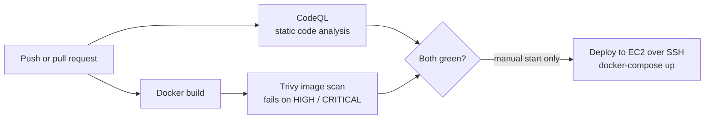

# Secure Flask App: DevSecOps Pipeline on AWS

[](https://github.com/nsatge1/secure-flask-devsecops/actions/workflows/ci-cd.yml)

A small Flask web app with a security-first CI/CD pipeline. Every push is scanned
twice (code and container image) before the app can be deployed to an AWS EC2 server.

The app itself is simple on purpose: the project is about the **pipeline**.

## Pipeline



| Stage | Tool | What it catches |
|---|---|---|
| Static analysis | GitHub CodeQL | Security bugs in the Python code (injection, unsafe calls) |
| Image scan | Trivy | Known vulnerabilities (CVEs) in the base image and Python packages |
| Deploy | SSH + rsync + Docker Compose | Runs only after both scans pass, and only when started by hand |

## Security controls

- **Least privilege:** the workflow token can only read the repository (`permissions: contents: read`). Only the CodeQL job can write security results.
- **Pinned actions:** every GitHub Action is pinned to a full commit SHA. In March 2026, attackers moved the version tags of `aquasecurity/trivy-action` to malicious code; a SHA cannot be moved.
- **Blocking scan:** Trivy fails the build on fixable HIGH or CRITICAL vulnerabilities.
- **Host key check:** the deploy job checks the server's SSH host key (`known_hosts`), so a fake server cannot take the connection.
- **Non-root container:** the app runs as `appuser`, not root, on `python:3.12-slim`. Only `app.py` is copied into the image.
- **Pinned dependencies + Dependabot:** Python packages, the Docker base image and the actions get monthly update pull requests.

## Run it locally

```bash
docker compose up --build
curl http://localhost:5000/health   # {"status":"ok"}
```

## Deploy

1. Start an Ubuntu EC2 instance with Docker and Docker Compose, and open port 5000 to your IP only.
2. Add these repository secrets:

   | Secret | Value |
   |---|---|
   | `EC2_HOST` | Public DNS name or IP of the instance |
   | `EC2_USERNAME` | `ubuntu` |
   | `EC2_SSH_KEY` | The private key of the instance key pair |
   | `EC2_KNOWN_HOSTS` | Output of `ssh-keyscan <EC2_HOST>`, checked against the EC2 console |

3. In the **Actions** tab, open *CI/CD Flask App* and click **Run workflow** on `main`.

## Roadmap

- [ ] Replace SSH keys with GitHub OIDC + AWS Systems Manager (no long-lived secret, no open port 22)
- [ ] Push the image to Amazon ECR and scan it there too
- [ ] Put the app behind HTTPS (Application Load Balancer + ACM certificate)
- [ ] Infrastructure as code with Terraform

## License

Apache 2.0
